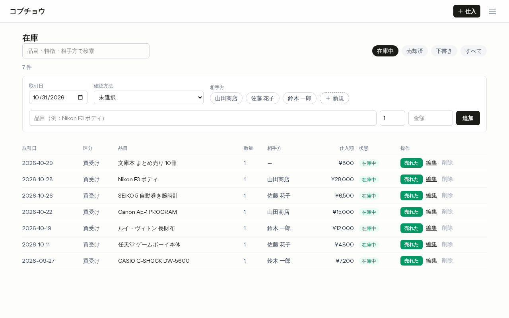
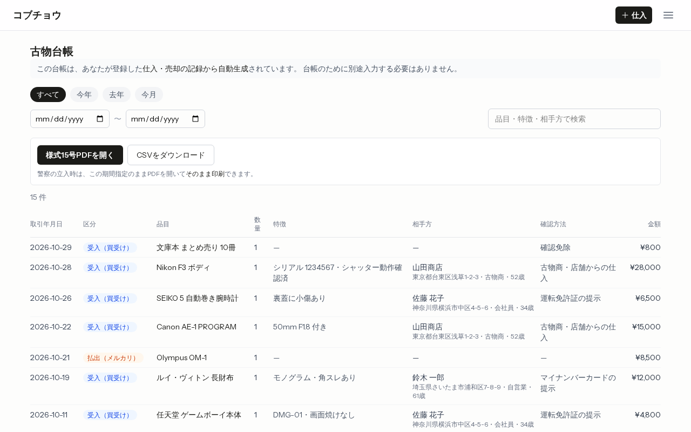
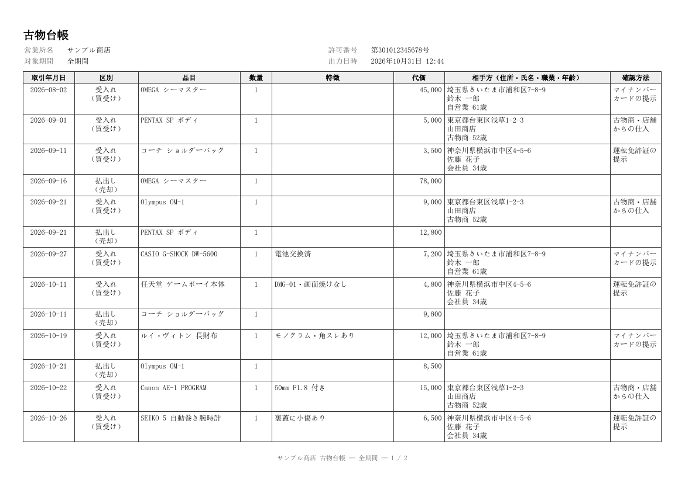

# 古物台帳アプリ「コブチョウ」ミニ版

古物商向けの台帳 SaaS「[コブチョウ](https://kobucho.com)」から、仕入・売却・古物台帳の部分だけを切り出した公開用のリポジトリです。本体は2026年6月から個人で企画・開発・運営しており、ソースは非公開です。

仕入と売却を記録すると、古物営業法で義務づけられている**古物台帳（施行規則 別記様式第15号）が自動ででき、そのまま PDF で印刷できます**。



## このリポジトリで見てほしいこと

| 見てほしいこと | どこを見るか |
| --- | --- |
| **1. 法令の要件を、テーブルの構造とコードに落とし込む**<br>台帳を保存せず記録から毎回作る、在庫の状態を列で持たない、など | [設計の判断](#設計の判断) ・ [`app/Services/LedgerService.php`](app/Services/LedgerService.php) ・ [`database/migrations/`](database/migrations/) |
| **2. AI に渡す開発規約と、守られたかを機械で確かめる仕組み**<br>実装の多くを生成 AI に任せる前提で、規約を文書にし、機械で確かめられるものはツールにした | [`AGENTS.md`](AGENTS.md) ・ [`docs/conventions/`](docs/conventions/) ・ [規約とその確かめ方](#規約とその確かめ方) |
| **3. 動きをテストで固定してから変える**<br>画面は Vue 3 から React 19 へ移行済み。移行の前に E2E で画面の動きを固定した | [`tests/Feature/`](tests/Feature/)（PHPUnit 148本） ・ [`tests/e2e/`](tests/e2e/)（Playwright 40本） ・ [`.github/workflows/ci.yml`](.github/workflows/ci.yml) |

## 画面

| 古物台帳（受入れ・払出しの時系列1表） | 様式15号の PDF（立入検査のときにそのまま印刷） |
| --- | --- |
|  |  |

スマホでは一覧がカードになり、仕入の登録はモーダルで行います（[スマホの画面](docs/images/inventory-mobile.png)）。

## 技術構成

- **サーバー**：PHP 8.3 / Laravel 13 / MySQL（開発とテストは SQLite）/ mpdf（日本語 PDF）
- **画面**：Inertia 3 + React 19 + TypeScript / Wayfinder（ルートから TS の関数を生成）/ shadcn/ui / Tailwind CSS 4 / Vite+（ビルド・Oxfmt・Oxlint）
  - Laravel 公式の React スターターキットと同じ構成です。REST API は作らず、コントローラが画面に props を渡します
- **設計**：Controller → Service → Repository の層分け。Service と Repository はインターフェース（`app/Contracts/`）越しに注入しています
- **テスト・解析**：PHPUnit（Feature 中心）/ Playwright（E2E）/ PHPStan + Larastan（自作ルール2つ）/ PHP_CodeSniffer（自作ルール1つ）/ ESLint（命名規約のみ）
- **CI**：GitHub Actions で、整形・Lint・型チェック・規約・PHPUnit と E2E を並行して実行。依存パッケージの脆弱性スキャンを毎週実行

## 設計の判断

### 台帳は保存せず、仕入と売却の記録から毎回作る

古物台帳には、受入れ（仕入）と払出し（売却）を取引の順に記録します。台帳用のテーブルを作って二重に書くと、仕入を直したのに台帳が古いまま、というずれが起きます。そこで台帳は保存せず、`purchases` と `sales` から**表示や出力のたびに組み立てて**います（[`LedgerService::buildRows`](app/Services/LedgerService.php)）。

売却を記録すれば台帳に払出しの行が出て、売却を取り消せば消えます。台帳のために別の入力は要りません。

### 在庫の状態は列で持たない

「在庫中・売却済・下書き」は、`status` 列を持たずに「売却の記録があるか」「下書きか」から決めています（[`PurchaseService::deriveStatus`](app/Services/PurchaseService.php)）。状態の列を持つと、売却を記録したのに状態を変え忘れる、といった食い違いの余地ができるためです。

### 「区別」は法令の言葉どおりに持つ

様式15号の「区別」欄は、受入れなら**買受け／委託**の2つです（別記様式第15号 備考1）。最初は「交換」「返品」も選べるようにしていましたが、法令を読み直して2値にしました（[`app/Enums/Kubun.php`](app/Enums/Kubun.php)）。払出しの区別は、委託で預かった品を売ったときは「委託に基づく引渡し」、買い受けた品なら「売却」と、受入れの区別から自動で付けています。

### 消さない・消させない

- 台帳は3年間の保存義務があるため、仕入と売却は**論理削除**にしています。DB の外部キーも、記録が残っている利用者・仕入の行は物理削除できない設定です（`restrictOnDelete`）
- 売却済みの仕入は、削除も下書きへの戻しもできません。どちらも台帳に払出しの行だけが残るためで、先に売却を取り消してもらいます
- 日付の順番を守ります。売却日は仕入日より前にできず、売却済みの仕入日を売却日より後にもできません
- 下書き（現場で金額と写真だけ控えたもの）は、法定の記載事項がそろっていないので台帳に載せません
- 本番では `migrate:fresh` などの DB を消すコマンドを実行できないようにしています（[`AppServiceProvider::configureDefaults`](app/Providers/AppServiceProvider.php)）

### 1件の仕入に1件の売却

まとめて仕入れた品を分けて売る形（ロットの分割）は扱わず、1件の仕入に売却は1件までとしています。対象の利用者（副業・個人の古物商）の取引ではほぼ困らず、台帳の組み立てと粗利の計算を単純に保てるためです。

この「1件まで」は、入力チェックだけでなく Service でも守っています。二重送信で2つのリクエストが同時に入力チェックを通っても、売却の登録は仕入の行をロックしてから確かめ直すので、2件目は登録されません（[`SaleService::register`](app/Services/SaleService.php)）。仕入の更新・削除と写真の追加も、同じように行をロックしてから確かめています。

### 個人情報と写真

- 相手方の住所・職業・年齢はログに残しません（氏名のみ）
- 仕入の写真は**Web から直接見えない場所**に保存し、所有者を確かめるルート（`GET /photos/{id}`）から配信します。他人の写真は URL を知っていても 404 です
- ログインには2段のレート制限をかけています。「メールアドレス＋IP」で毎分5回（1アカウントへの総当たり）と、「IP」で毎分20回（メールアドレスを変えながら試す攻撃）です
- 台帳の CSV では、`=` `+` `-` `@` で始まる文字の先頭に `'` を付け、表計算ソフトで開いたときに数式として動かないようにしています（CSV インジェクション対策）
- 検索語の `%` と `_` は、ワイルドカードではなくその文字として探します（[`LikePattern`](app/Support/LikePattern.php)）

### 失敗したときの見せ方をそろえる

画面からの操作が失敗したとき（権限なし・対象なし・サーバーエラー・ページの期限切れ）は、元の画面へ戻してトーストで理由を伝え、入力は残します。画面を開いたままセッションが切れていた場合は、操作を成功扱いにせず、ログイン画面を開き直します（[`AppServiceProvider::configureInertiaExceptions`](app/Providers/AppServiceProvider.php)）。

### いまの作りの限界

台帳は、期間と検索語で絞った仕入と売却をそれぞれ取得し、PHP で日付順に並べてからページに分けています。個人の古物商の取引件数（年に数百〜数千件）なら問題ありませんが、件数が大きく増えるなら、`UNION ALL` で並べ替えとページ分けまでを SQL に任せる形に変えます。

## 規約とその確かめ方

実装の多くは生成 AI に任せています。基準を渡さないと、AI は毎回違う書き方をします。そこで、

1. 書き方の基準を**文書にして AI に読ませる**（[`AGENTS.md`](AGENTS.md) が入口、本体は [`docs/conventions/`](docs/conventions/) の10文書とレビューの確認表）
2. そのうち**機械で線を引けるものはツールで確かめ**、CI と push 前のフックで流す
3. 機械で確かめられないものは、確認表（[`90-review-checklist.md`](docs/conventions/90-review-checklist.md)）でレビューする

という3段にしています。ツールで確かめている規約は次のとおりです。

| 規約 | 確かめるツール | 設定 |
| --- | --- | --- |
| 配列の変数名は `List` で終わる／自分で書いた関数に `on*`・`handle*` を付けない／型名を `Data` で終わらせない／ファイル直下の定数は大文字 | ESLint（typescript-eslint の naming-convention） | [`eslint.config.ts`](eslint.config.ts) |
| 配列の値に条件式を書かない（先に `if` で変数を決める） | PHPStan の自作ルール | [`NoConditionInArrayValueRule`](tests/PHPStan/Rules/NoConditionInArrayValueRule.php) |
| Repository で `count()` してから `first()` で取り直さない | PHPStan の自作ルール | [`NoCountThenFirstRule`](tests/PHPStan/Rules/NoCountThenFirstRule.php) |
| アロー関数は `fn()`（空白なし）・キャストのあとに空白を入れない・メソッドのあいだは3行 | PHP_CodeSniffer（自作ルールを含む） | [`phpcs.xml`](phpcs.xml) ・ [`phpcs/Kobucho/`](phpcs/Kobucho/) |
| PHP の型 | PHPStan + Larastan（レベル5） | [`phpstan.neon`](phpstan.neon) |
| 整形・一般的な Lint・TS の型 | Oxfmt・Oxlint（Vite+）・tsc | [`vite.config.ts`](vite.config.ts) |

PHP の整形に Laravel Pint を使っていないのは、Pint の既定の書き方と、この規約（メソッドのあいだを3行空ける・`fn()` に空白を入れない、など）が合わないためです。規約に合わせた確認だけを PHP_CodeSniffer で行っています。

## テスト

- **PHPUnit（148本）**：Feature テストが中心です。画面に渡る props の形、他人のデータに触れないこと、台帳の行の並びと法定の記載事項、レート制限、ログの振り分けと相手方の個人情報がログに残らないことなどを確かめています
- **Playwright（40本）**：実際のブラウザで、仕入の連続登録・下書き・売却と取消・台帳の絞り込みと PDF/CSV の出力・スマホの画面・セッション切れなどを通します。DB はファイルの SQLite、サーバーは `php -S` なので、外部サービスなしで動きます

### Vue から React への移行

画面は最初 Vue 3 の SPA で作り、2026年9月に React 19 + Inertia（Laravel 公式のスターターキットの構成）へ移しました。移行の前に Vue 版に対して E2E を書いて全部通る状態にし、同じテストが React 版でも通ることを確かめてから切り替えています。E2E のコメントに「移行前の Vue 版」とあるのはこのためです（移行の履歴は非公開の本体のリポジトリにあります）。

## 手元で動かす

PHP 8.3 以上・Composer・Node 22.12 以上が必要です。

```bash
composer install
npm ci
cp .env.example .env
php artisan key:generate
touch database/database.sqlite
php artisan migrate --seed
npm run build
php artisan serve
```

`http://127.0.0.1:8000` を開き、`demo@example.com` / `password` でログインできます（営業所名・許可番号を設定済みで、台帳と PDF にサンプルの記録が出ます）。

テストと解析：

```bash
php artisan test        # PHPUnit
npm run e2e             # Playwright（初回は npx playwright install chromium）
npm run check           # 整形・Lint
npm run types:check     # TypeScript の型
npm run lint:naming     # 命名規約（ESLint）
composer phpstan        # PHP の型と自作ルール
composer phpcs          # PHP の書き方
```

push の前に同じ解析とテストを流すには、`git config core.hooksPath .githooks` を一度実行してください。

## 本体から外したもの

公開用に、次のものはこのリポジトリに入れていません：課金（Stripe）と有料プラン、損益レポートと確定申告用の CSV、管理画面、お問い合わせ、メール送信（パスワードの再設定を含む）、本番サーバーへのデプロイ。

## ライセンス

ポートフォリオとして公開しているもので、ライセンスは付けていません（閲覧のみを想定しています）。
